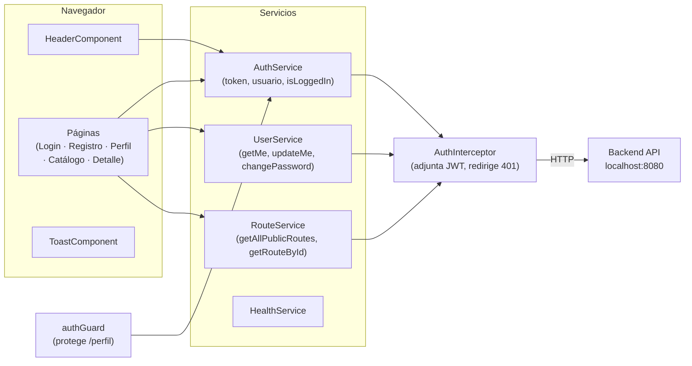

# FusaRoute Frontend

Interfaz web para el sistema de información de transporte público de Fusagasugá.
Proyecto Integrador de Ingeniería de Software I, Universidad de Cundinamarca.

[](https://sonarcloud.io/summary/new_code?id=sabego2006_FusaRoute-FRONTEND)
[](https://sonarcloud.io/summary/new_code?id=sabego2006_FusaRoute-FRONTEND)

> Los badges quedan en gris **hasta que el admin importe el repo en SonarCloud y corra el
> primer análisis en CI**. Ver [`docs/calidad/sonarqube.md`](docs/calidad/sonarqube.md).

## Stack

| | Versión |
|---|---|
| Angular | **21** (zoneless — sin zone.js) |
| TypeScript | 5.9 |
| Node.js | 22 LTS |
| PWA | `@angular/service-worker` |
| Test runner | Vitest (vía `@angular/build:unit-test`) |

Se arranca en la versión vigente de cada herramienta, no en una anterior. Un salto de
versión mayor es una decisión propia, con su tarjeta; no se hace a mitad de sprint.

## Requisitos

- **Node.js ≥ 22.12** (LTS). Si se usa `nvm`: `nvm use` lee el `.nvmrc`.
- Backend corriendo en `http://localhost:8080` (ver el README del backend).

## Instalación y ejecución (ambiente DEV)

```bash
npm ci
cp .env.example .env      # y llenarlo
npm start                 # http://localhost:4200
```

`npm start` levanta el frontend contra el backend en `http://localhost:8080`, que es lo que
declara `src/environments/environment.ts`. El backend tiene que estar corriendo aparte.

## Producción

| | |
|---|---|
| Frontend | [`https://fusaroute.vercel.app`](https://fusaroute.vercel.app) (Vercel, build de `main`) |
| Backend | `https://fusaroute-backend.onrender.com` (Render, tier gratis) |

`environment.prod.ts` compila la URL del backend **dentro** del bundle en tiempo de build —
no hay variables de entorno en Vercel que leer ni que configurar. El `CORS_ALLOWED_ORIGINS`
del backend en Render debe incluir el dominio de Vercel para que las peticiones no den `403`.

**Cold start:** el backend duerme tras ~15 min de inactividad en el tier gratis de Render; el
primer request tras eso puede tardar hasta ~60 s.

### Verificación rápida

```bash
npm ci              # instalar dependencias
npx ng build        # compilar (debe salir sin errores)
npx ng test         # ejecutar los tests (Vitest)
```

## Arquitectura



### ¿Por qué signals y no zone.js?

Angular 21 corre en modo **zoneless** por defecto: no hay `zone.js` que detecte cambios
automáticamente tras un evento asíncrono. Los componentes usan `signal()` y `computed()`
para que Angular sepa qué cambió y cuándo re-renderizar. Sin signals, un error asignado
a una variable normal después de un `subscribe()` no se refleja en la vista — el error
queda "invisible", que es justamente el bug que se corrigió en login, registro y health-check.

### Interceptor de autenticación

El interceptor (`core/interceptors/auth.interceptor.ts`) adjunta el header
`Authorization: Bearer <token>` a cada petición HTTP, con dos excepciones:

1. **No adjunta token en `/api/auth/**`**: evita que un token vencido en localStorage
   provoque un 401 espurio al intentar registrarse o iniciar sesión.
2. **No redirige al login en 401 de rutas de auth**: un 401 en `/api/auth/login` es
   "credenciales incorrectas", no "sesión expirada" — se muestra el error, no se redirige.

## Pantallas

| Ruta | Componente | Auth requerida |
|---|---|---|
| `/rutas` | RoutesListComponent | No |
| `/rutas/:id` | RoutesDetailComponent | No |
| `/registro` | RegisterComponent | No |
| `/login` | LoginComponent | No |
| `/perfil` | ProfileComponent | Sí (authGuard) |
| `/health` | HealthCheckComponent | No |

## PWA

La aplicación es instalable desde el navegador («Añadir a pantalla de inicio»), sin pasar por
Play Store ni App Store. El service worker **está desactivado en `ng serve`** a propósito;
para probar la instalación hay que servir el build:

```bash
ng build
npx http-server -p 8081 -c-1 dist/fusaroute-frontend/browser
```

Solo funciona sobre HTTPS o sobre `localhost` — es una regla del navegador. Y ojo: el service
worker hace que **la app cargue** sin red; **no** es el modo offline del requisito, que es un
endpoint del backend que calcula la ruta por distancia sobre los GeoJSON.

## Seguridad

**Ninguna clave secreta va en este repositorio.** Todo lo que se compila en Angular viaja al
navegador y es inspeccionable; los secretos viven solo en el backend. `.env.example` está
versionado con los valores vacíos y es la lista de las variables que existen.

## Mapa del repo

Pedido del comité del 28-sep: dar entrada rápida al código para quien lo abre por primera
vez. Lo que sigue es lo que **ya existe** en el repo hoy; no hay carpetas placeholder.

### Árbol

```
src/
├── app/
│   ├── pages/                       pantallas enrutadas (lo que ve el usuario)
│   │   ├── auth/
│   │   │   ├── login/               LoginComponent
│   │   │   └── register/            RegisterComponent
│   │   ├── health-check/            HealthCheckComponent (/health)
│   │   ├── profile/                 ProfileComponent (protegida)
│   │   └── routes/
│   │       ├── routes-list/         catálogo público (/rutas)
│   │       └── routes-detail/       detalle de una ruta (/rutas/:id)
│   ├── components/                  piezas de UI reutilizables
│   │   ├── header/                  HeaderComponent (barra superior)
│   │   └── toast/                   ToastComponent + ToastService (avisos)
│   ├── services/                    clientes HTTP; único lugar que llama al backend
│   │   ├── auth.service.ts
│   │   ├── user.service.ts
│   │   ├── route.service.ts
│   │   └── health.service.ts
│   ├── core/
│   │   ├── guards/
│   │   │   └── auth.guard.ts        protege /perfil
│   │   └── interceptors/
│   │       └── auth.interceptor.ts  adjunta JWT y maneja 401
│   ├── models/                      interfaces TypeScript del dominio
│   │   ├── auth.model.ts
│   │   └── route.model.ts
│   ├── lib/                         utilidades puras, sin estado
│   │   ├── format.ts                formato de moneda COP, horas
│   │   └── route-steps.ts           reducción de barrios a ≤7 pasos
│   ├── app.config.ts                providers de la aplicación
│   ├── app.routes.ts                tabla de rutas
│   └── app.ts / app.html / app.css  shell raíz
├── environments/
│   ├── environment.ts               DEV: apunta a http://localhost:8080
│   └── environment.prod.ts          PROD: apunta a Render
public/
├── favicon.ico
└── manifest.webmanifest             PWA (nombre, íconos, theme-color)
.github/workflows/
├── ci.yml                           build + test en cada PR
└── security.yml                     escaneo de dependencias
```

### Para qué sirve cada carpeta

| Carpeta | Qué hay y para qué |
|---|---|
| `src/app/pages/` | Una carpeta por pantalla con ruta propia. Los componentes son `standalone` y se cargan con `loadComponent` (lazy). |
| `src/app/components/` | UI que se reutiliza entre pantallas (header, toast). No tienen ruta propia. |
| `src/app/services/` | Clientes HTTP tipados. Es el **único** sitio que usa `HttpClient`; si una página necesita datos del backend, los pide a un service. |
| `src/app/core/guards/` | `CanActivateFn` que decide si una ruta se puede abrir. Hoy solo `authGuard` para `/perfil`. |
| `src/app/core/interceptors/` | Middleware HTTP funcional. `authInterceptor` adjunta el `Authorization: Bearer` y centraliza la respuesta a `401`. |
| `src/app/models/` | `interface` / `type` que reflejan el dominio del backend (usuario, ruta, respuesta de login). Sin `any`. |
| `src/app/lib/` | Utilidades puras: formateo de pesos colombianos, reducción de la lista de barrios a los 7 pasos que exige la UI. |
| `src/environments/` | Configuración por ambiente que se compila **dentro** del bundle (`apiUrl`, `production`). No es un `.env` en runtime. |
| `public/` | Activos servidos tal cual en la raíz: `favicon.ico` y el `manifest.webmanifest` que convierte la app en PWA instalable. |
| `.github/workflows/` | Pipelines de CI. `ci.yml` corre `ng build` + `ng test` en cada PR; `security.yml` revisa vulnerabilidades de dependencias. |

### Recorrido punta a punta del login

Flujo real cuando alguien envía el formulario en `/login`:

1. **Formulario reactivo** — [`src/app/pages/auth/login/login.component.ts`](src/app/pages/auth/login/login.component.ts). El `FormGroup` valida correo y contraseña; `onSubmit()` corta si el form está inválido y llama a `authService.login(this.loginForm.value)`.
2. **Servicio de auth** — [`src/app/services/auth.service.ts`](src/app/services/auth.service.ts). `login()` hace `POST ${environment.apiUrl}/api/auth/login` con `HttpClient`.
3. **Interceptor HTTP** — [`src/app/core/interceptors/auth.interceptor.ts`](src/app/core/interceptors/auth.interceptor.ts), registrado en [`src/app/app.config.ts`](src/app/app.config.ts) vía `withInterceptors`. Como la URL contiene `/api/auth/`, el interceptor **no** adjunta token (evita rebotes por un JWT viejo); la petición sale limpia.
4. **Backend** — responde `{ token, expiresAt, user }` (ver `LoginResponse` en `src/app/models/auth.model.ts`).
5. **Persistencia** — el `tap` del `login()` llama a `saveSession()`, que escribe `token`, `expiresAt` y `user` en `localStorage` y actualiza los `signal` de `AuthService` (`token`, `expiresAt`, `currentUser`). El `computed` `isLoggedIn` recalcula y queda en `true`.
6. **Redirect** — el componente de login hace `router.navigate(['/rutas'])`.
7. **Guard de ruta** — más tarde, al abrir `/perfil`, Angular ejecuta [`src/app/core/guards/auth.guard.ts`](src/app/core/guards/auth.guard.ts) (declarado en `canActivate` de `/perfil` en [`src/app/app.routes.ts`](src/app/app.routes.ts)). El guard inyecta `AuthService` y lee `isLoggedIn()`: si es `true` deja pasar; si es `false` devuelve `router.createUrlTree(['/login'])` y el usuario cae de vuelta al paso 1.
8. **401 posterior** — si cualquier petición autenticada (p. ej. `GET /api/users/me`) recibe `401`, el interceptor llama `auth.logout()` (limpia `localStorage` y los signals) y redirige a `/login`.

Un token válido dura una semana (RNF-04); al vencer, `isLoggedIn` pasa a `false` solo por el chequeo de fecha, sin necesidad de respuesta `401`.

## Troubleshooting

| Problema | Solución |
|---|---|
| Puerto 4200 ocupado | `npx ng serve --port 4201` |
| Token vencido y la app no carga | Limpiar localStorage: `localStorage.clear()` en la consola del navegador, recargar |
| `npm ci` falla por peer deps | El `.npmrc` ya tiene `legacy-peer-deps=true` — si se borró, recrearlo |
| Los mensajes de error no se ven | Verificar que el componente use `signal()`, no una variable normal (Angular 21 es zoneless) |
